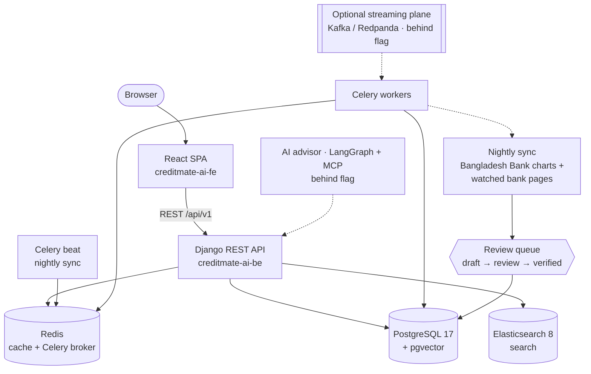

# CreditMate AI

A comparison platform for banking products in Bangladesh — credit cards, deposits, loans,
and bank accounts — built on published bank data with full provenance.

[](https://github.com/avoid-ashraful/creditmate-ai/actions/workflows/ci.yml)
[](https://github.com/avoid-ashraful/creditmate-ai/actions/workflows/workflow-audit.yml)
[](https://github.com/avoid-ashraful/creditmate-ai/actions/workflows/secret-scan.yml)
[](https://github.com/avoid-ashraful/creditmate-ai/actions/workflows/helm-ci.yml)
[](https://github.com/avoid-ashraful/creditmate-ai/actions/workflows/image-scan.yml)

## Project status

CreditMate AI is **pre-launch and in active development**. It is not yet deployed to
production. The core comparison product — catalogue, comparison tools, calculators,
eligibility checker and scoring — is built and tested. Newer capabilities (the AI advisor,
the Kafka streaming plane, and vector search) are merged behind feature flags that default
to off (`ADVISOR_ENABLED`, `EVENT_STREAMING_ENABLED`, `VECTOR_SEARCH_ENABLED`) and have not
been rolled out.

Data honesty is a product rule, not a disclaimer: every figure on the site comes from a
published source, eligibility results are labelled estimates, and nothing on CreditMate is
ever described as pre-approved or guaranteed.

## What it does

| Vertical | Catalogue | Highlights |
| --- | --- | --- |
| Credit cards | 135 catalogued · **105 public** | Side-by-side comparison (including a differences-only view and print/PDF export), the CreditMate Score with a published methodology, an income-based eligibility checker, EMI/payoff and reward value-back calculators |
| Deposits | **80 products · 367 rates** | FDR and DPS/schemes ingested from Bangladesh Bank's official rate chart; scenario ranking by net-of-tax maturity value; Sanchayapatra government savings certificates shown as benchmarks, never ranked against bank products |
| Loans | **50 products · 15 lenders** | Personal, home, car and secured loans; rates shown as the published **bands**, costed at both ends of the band — never as invented point rates |
| Bank accounts | **87 products · 11 banks** | Savings and current accounts ranked by net annual value at your balance, using each bank's published schedule of charges |

### Data principles

- **Published data only.** Rates, fees and features trace back to banks' published schedules
  of charges or Bangladesh Bank's official charts.
- **Provenance and history.** Product pages show where each figure came from and its
  fee-change history.
- **Draft → review → verified.** Automated crawling and extraction only ever create drafts
  in a review queue; no automated path can modify verified data.
- **Islamic products on their own terms.** Modelled as expected profit, never as interest;
  cards that publish no APR are never assigned a fake one.
- **Eligibility is an estimate.** The checker is income-based (Bangladesh has no consumer
  credit score) and quotes the published requirements behind each result.

## Repository map

This umbrella repository holds the platform layer. The application code lives in two
submodule repositories:

| Repository | Contents |
| --- | --- |
| **creditmate-ai** (this repo) | Helm chart and Kubernetes platform, monitoring stack, CI workflows, load tests, documentation and runbooks |
| [creditmate-ai-be](https://github.com/avoid-ashraful/creditmate-ai-be) | Django 5.2 / Django REST Framework API: catalogue, sync pipeline, eligibility, scoring, calculators, Celery workers — see its [README](https://github.com/avoid-ashraful/creditmate-ai-be#readme) |
| [creditmate-ai-fe](https://github.com/avoid-ashraful/creditmate-ai-fe) | React 18 + TypeScript single-page app: browsing, comparison, calculators, saved items and the advisor UI — see its [README](https://github.com/avoid-ashraful/creditmate-ai-fe#readme) |

## Architecture



For the full deployment diagram rendered from the Helm chart, see
[docs/diagrams/platform.md](docs/diagrams/platform.md).

## Platform

### Kubernetes (Helm)

The chart in [`charts/creditmate`](charts/creditmate) deploys the whole platform: the Django
API and React frontend, Celery worker and beat (single replica, `Recreate`), and a migration
Job that runs as a Helm hook. It includes ingress-nginx with cert-manager TLS, HPAs,
PodDisruptionBudgets, NetworkPolicies, and KEDA autoscaling of workers on Celery queue
length. The local profile renders in-cluster PostgreSQL 17 (pgvector image) and Redis;
staging and production values point at managed services and pull secrets via
ExternalSecrets. Values files: `values.yaml`, `values-local.yaml`, `values-staging.yaml`,
`values-production.yaml`. See the [chart README](charts/creditmate/README.md) for details.
(The older Kustomize manifests under [`k8s/`](k8s/) are deprecated and kept for reference.)

### Monitoring

[`monitoring/`](monitoring/) holds the kube-prometheus-stack provisioning: Prometheus
alerting rules, Grafana dashboards (including an AI cost & latency dashboard), Alertmanager
configuration and a postgres exporter.

### Nightly data sync

The backend's sync spine snapshots Bangladesh Bank's official deposit and lending rate
charts deterministically (auto-verified on ingest), and re-checks watched bank pages on a
change-gated basis — changed content becomes review drafts only, never edits to verified
data. It is designed to run nightly at 02:00 Asia/Dhaka from Celery beat once the worker and
beat services are deployed.

### CI

- **CI** (`.github/workflows/ci.yml`): per-app backend test matrix against PostgreSQL,
  Redis and Elasticsearch service containers; frontend checks, Jest suites and production
  build; Playwright end-to-end and visual-regression jobs; Kubernetes and monitoring
  validation; Docker images built on pull requests and published to GHCR
  (`ghcr.io/avoid-ashraful/creditmate-ai-backend`, `ghcr.io/avoid-ashraful/creditmate-ai-frontend`)
  only on `v*` version tags.
- **Workflow audit (zizmor)**: statically audits the workflow files themselves.
- **Secret scan (gitleaks)**: scans pull-request commits and, weekly, the full history.
- **Helm chart CI**: lints the chart, renders every values profile, validates the output
  against Kubernetes schemas, and runs the chart's unit tests.
- **Image scan (Trivy)**: configuration and image vulnerability scanning.

The backend and frontend repositories run their own suites (pytest, black/flake8/isort,
pip-audit and bandit; Jest, type checks and Storybook) plus a nightly LLM-evaluation
workflow in the backend repo. See [docs/ci.md](docs/ci.md) for the umbrella CI in detail.

## Getting started

```bash
git clone --recurse-submodules https://github.com/avoid-ashraful/creditmate-ai.git
cd creditmate-ai
```

### Local stack (no Kubernetes)

One script brings up PostgreSQL, the Django API and the built frontend, seeded with the
verified card dataset:

```bash
scripts/dev-up.sh      # API on :8010, frontend on :3010
scripts/dev-down.sh    # stop it
```

Full details, environment variables and troubleshooting are in
[docs/LOCAL_DEV.md](docs/LOCAL_DEV.md). [QUICKSTART.md](QUICKSTART.md) gives the broader
repository orientation and per-area development commands.

### Kubernetes route (k3d)

Requires Docker, k3d, kubectl and Helm:

```bash
scripts/cluster-up.sh              # k3d cluster + ingress-nginx, cert-manager, metrics-server, KEDA, kube-prometheus-stack
scripts/cluster-up.sh --with-app   # also install the CreditMate chart with local values
scripts/cluster-up.sh --down       # delete the cluster
```

Rollback procedure: [docs/runbooks/k8s-rollback.md](docs/runbooks/k8s-rollback.md).

## Documentation

- [docs/LOCAL_DEV.md](docs/LOCAL_DEV.md) — running the verified local stack
- [QUICKSTART.md](QUICKSTART.md) — repository orientation and per-area commands
- [docs/PRODUCT_REVIEW_2026-10.md](docs/PRODUCT_REVIEW_2026-10.md) — product review:
  capabilities, market sources, prioritised follow-ups
- [ENHANCEMENT_PLAN.md](ENHANCEMENT_PLAN.md) — original enhancement plan (historical;
  partly superseded by the product review)
- [docs/ci.md](docs/ci.md) — how the CI workflows fit together
- [docs/diagrams/platform.md](docs/diagrams/platform.md) — platform architecture diagram
- [charts/creditmate/README.md](charts/creditmate/README.md) — Helm chart guide
- [monitoring/README.md](monitoring/README.md) — monitoring stack notes
- [docs/runbooks/](docs/runbooks/) — operational runbooks, including
  [k8s-rollback.md](docs/runbooks/k8s-rollback.md)
- [load-tests/README.md](load-tests/README.md) — k6 load tests

## Contributing

CreditMate AI is currently a solo-maintained project. Bug reports and suggestions are
welcome via GitHub issues; pull requests should reference an issue and keep the data-honesty
rules above intact. No open-source licence has been chosen for this repository yet.
