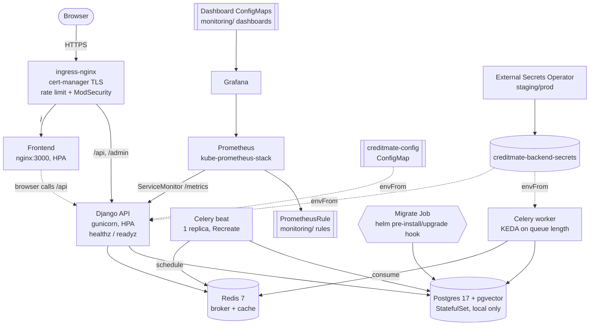

# CreditMate platform architecture (Helm / Kubernetes)

Rendered from the chart in `charts/creditmate/`. Local profile shown;
staging/production replace the in-cluster Postgres/Redis with managed
external services and the chart-rendered Secret with an ExternalSecret.

NetworkPolicies (chart default): default-deny for all CreditMate pods, then
explicit allows — ingress→frontend/API, frontend→API, backend-side pods→
Postgres/Redis/HTTPS, monitoring→API scrape, KEDA→Redis.
